# WADF-105 Lab 1: Two-VM Network Commissioning

## Student Details

- Name: Ayodele Banjo
- Student ID: C11/26/FCDF/17169
- Institution: International Cybersecurity and Digital Forensics Academy
- Date: 6 October 2026

## Laboratory Objective

The objective of this laboratory was to commission a protected virtual network using an Ubuntu client and an OPNsense firewall. I configured the virtual adapters, verified addressing and routing, tested connectivity and DNS resolution, accessed the firewall management interface, and captured ARP, ICMP and DNS traffic using Wireshark.

## 1. VirtualBox Network Configuration

I used the supplied Ubuntu client and OPNsense firewall virtual machines.

Following the instructor's correction, I configured the adapters as follows:

| Virtual Machine | Adapter | Attachment | Network |
|---|---|---|---|
| OPNsense firewall | Adapter 1 | Internal Network | ICDFA-LAN |
| OPNsense firewall | Adapter 2 | NAT | VirtualBox NAT |
| Ubuntu client | Adapter 1 | Internal Network | ICDFA-LAN |

Both internal adapters used the exact, case-sensitive name ICDFA-LAN.

The LAN interface connects OPNsense to the protected Ubuntu network. The WAN interface connects OPNsense to VirtualBox NAT, providing an upstream path to the internet.

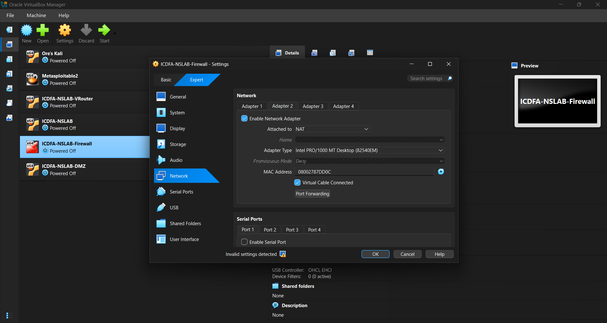

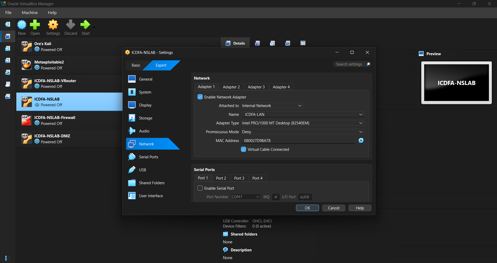

## 2. OPNsense Interface Verification

I started the firewall first and waited for the OPNsense console menu before starting Ubuntu.

The console showed the following IPv4 interface assignments:

| Interface | Device | IPv4 Address | Subnet Mask |
|---|---|---|---|
| LAN | em0 | 10.10.10.1/24 | 255.255.255.0 |
| WAN | em1 | 10.0.3.15/24 | 255.255.255.0 |

The WAN address was obtained through DHCP from VirtualBox NAT.

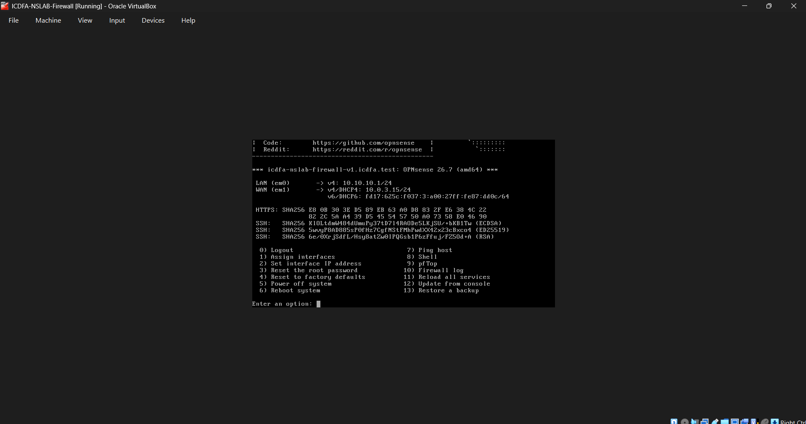

## 3. Ubuntu IPv4 Address Verification

I ran:

    ip -4 -br address

The enp0s3 interface was UP and had IPv4 address 10.10.10.126/24.

The /24 prefix corresponds to subnet mask 255.255.255.0. The client and firewall LAN interface were therefore on the same 10.10.10.0/24 subnet.

The loopback address 127.0.0.1 is used for communication within the Ubuntu machine.

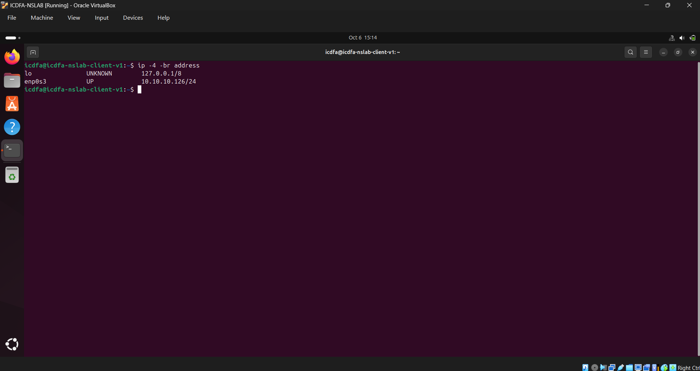

## 4. Default Gateway Verification

I ran:

    ip route

The routing table showed a default route through 10.10.10.1 using enp0s3.

OPNsense is the client's default gateway because it provides the route to destinations outside the local subnet. Ubuntu sends traffic for external networks to 10.10.10.1, where OPNsense applies firewall rules and routes permitted traffic through its WAN interface.

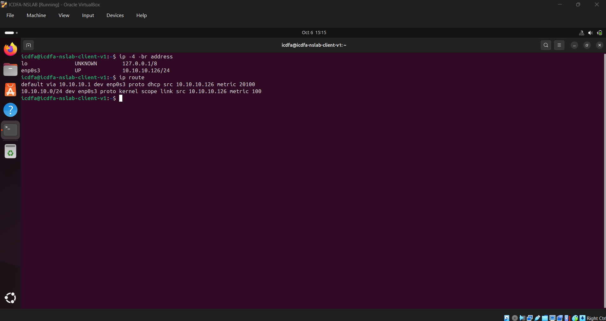

## 5. DNS Configuration

I ran:

    resolvectl status

The output showed 10.10.10.1 as the DNS server for enp0s3 and icdfa.test as the DNS domain.

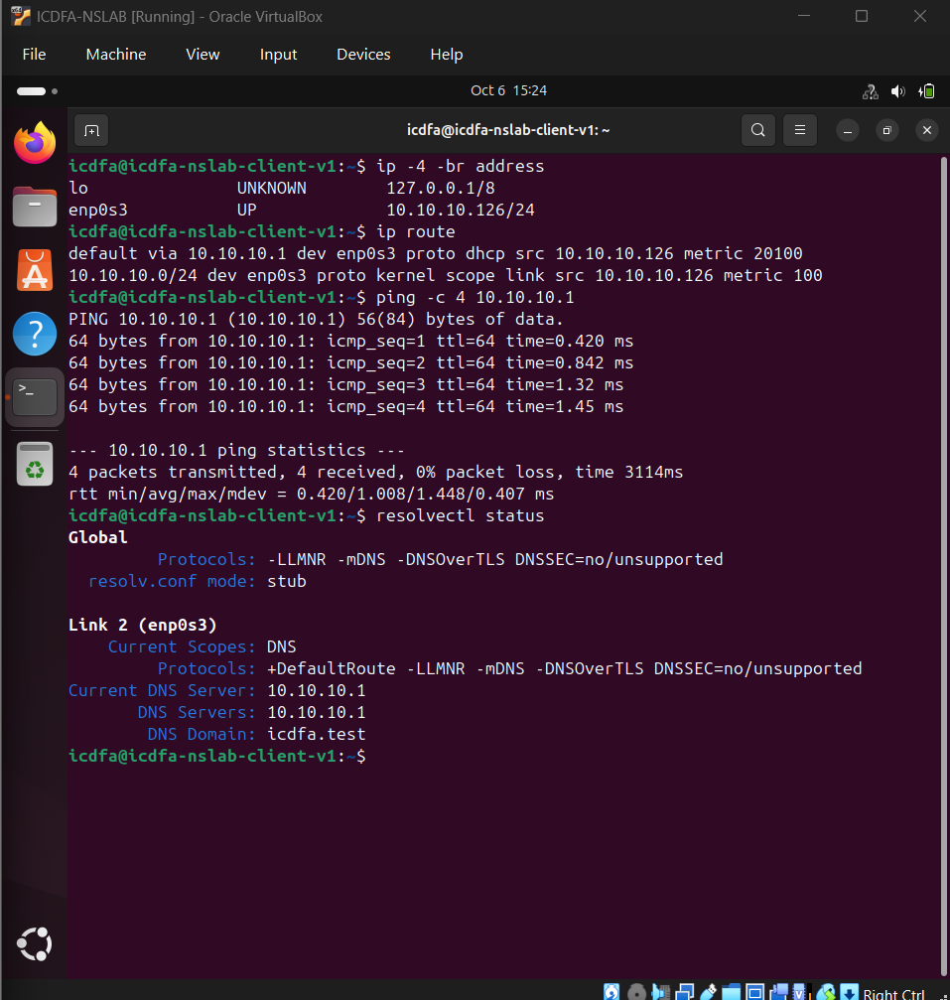

## 6. Local Connectivity Test

I ran:

    ping -c 4 10.10.10.1

All four requests received replies, with 0% packet loss. This confirmed connectivity between Ubuntu and the OPNsense LAN gateway.

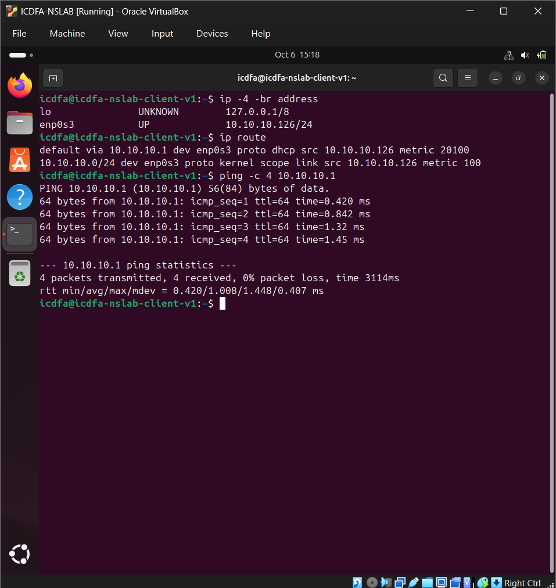

## 7. Internet Connectivity and Troubleshooting

Initially, the client's ping to 1.1.1.1 returned "Destination Host Unreachable" from 10.10.10.1.

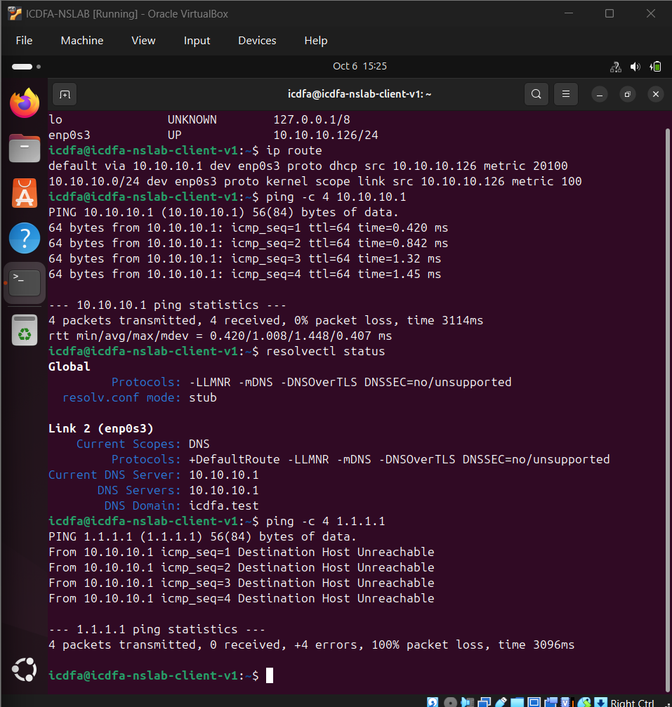

A ping from the firewall also failed. I inspected its IPv4 routing table using:

    netstat -rn -f inet

The routing table did not contain a default route.

In the OPNsense gateway configuration, I disabled the old VROUTER_GW entry and enabled WAN_DHCP, with gateway address 10.0.3.2, as the upstream IPv4 gateway. I saved and applied the changes.

I repeated:

    ping -c 4 1.1.1.1

The final test received four replies with 0% packet loss. This demonstrated successful IPv4 internet connectivity through the firewall.

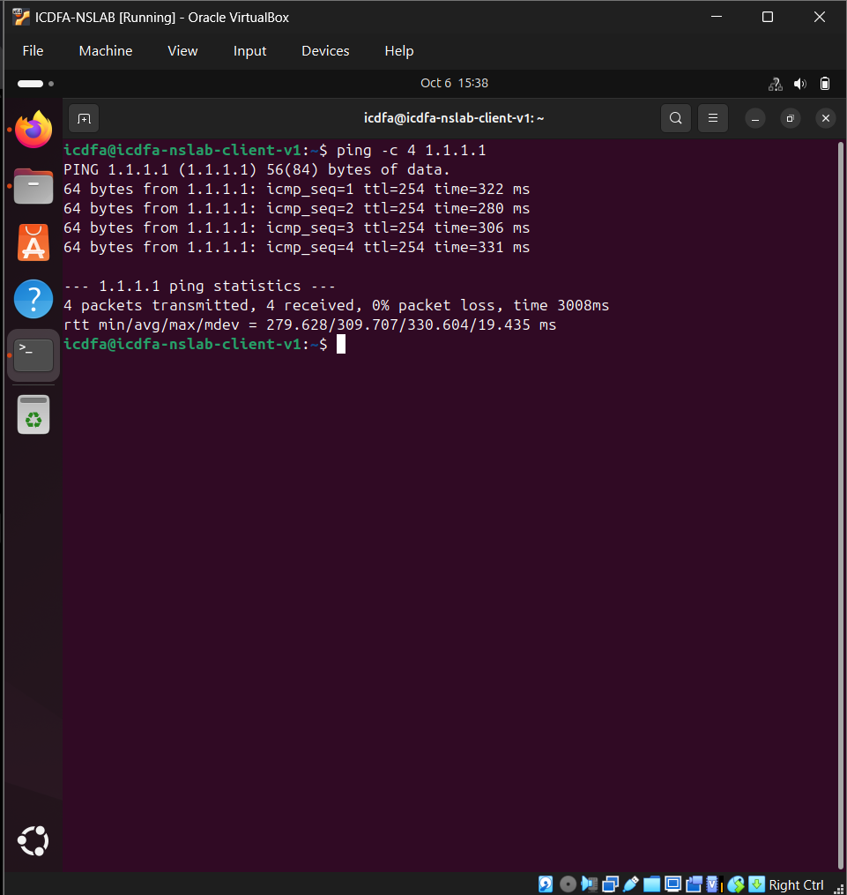

## 8. DNS Resolution Test

I ran:

    getent hosts opnsense.org

The command returned:

    2001:1af8:2050:a001:1::1 opnsense.org

This confirmed successful name resolution. The returned address is an IPv6 address.

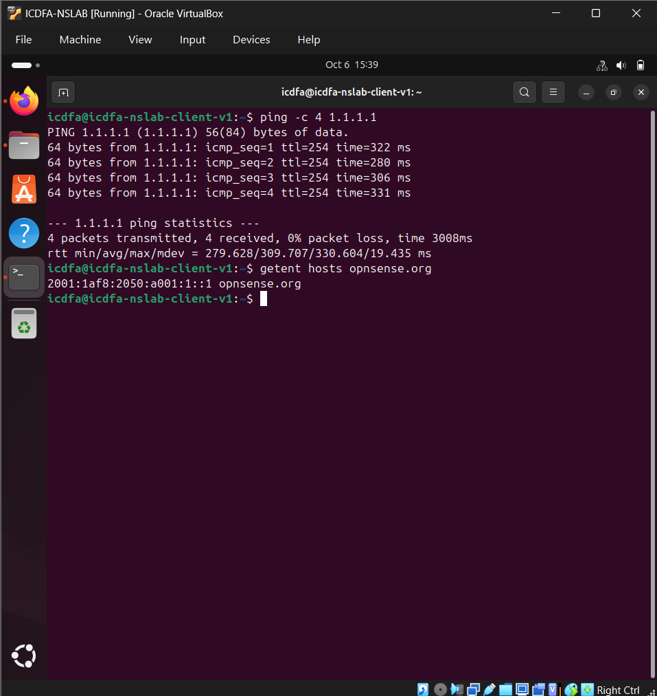

## 9. HTTPS Connectivity Test

I ran:

    curl -I https://opnsense.org

The server returned HTTP/1.1 200 OK. This confirmed that the client could resolve the hostname and obtain an HTTPS response through the laboratory network.

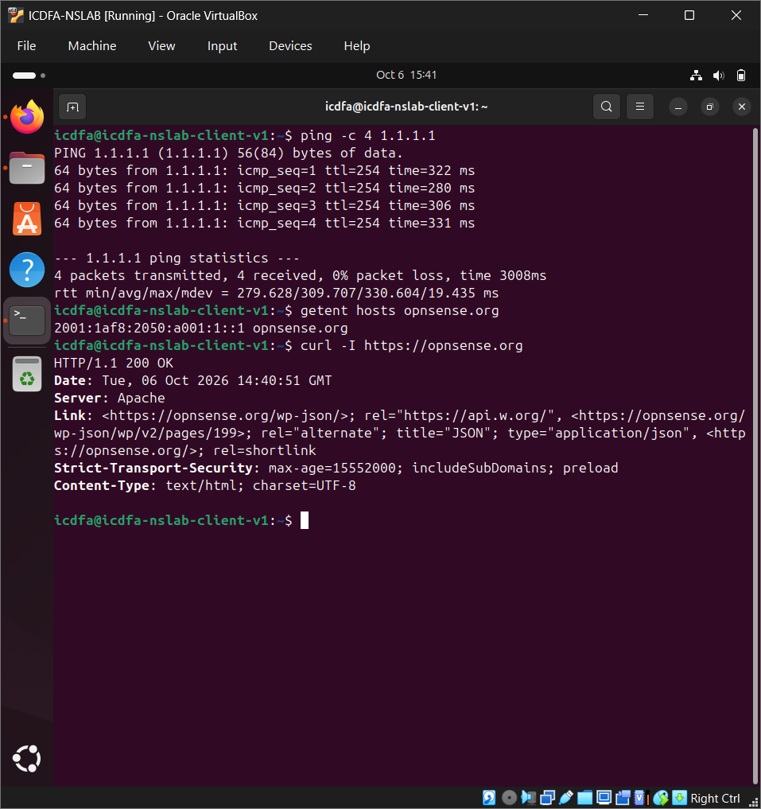

## 10. OPNsense Management Access

I accessed https://10.10.10.1 from Firefox inside the Ubuntu VM and logged in using the credentials supplied by ICDFA.

The dashboard showed both LAN and WAN links up, with the expected IPv4 addresses.

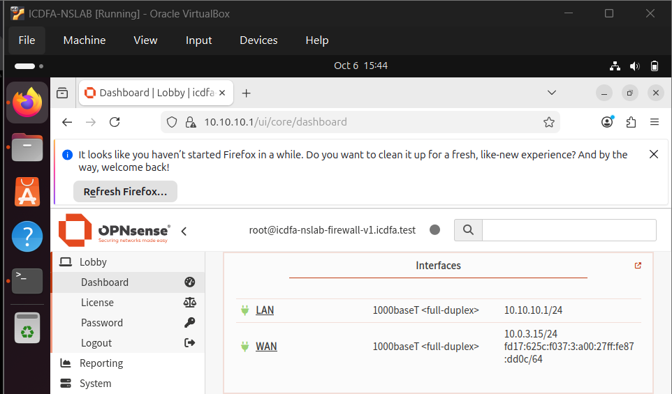

## 11. Wireshark Packet Capture and Analysis

I captured traffic on the Ubuntu client's enp0s3 interface and saved the capture as ICDFA_Lab01_ARP_ICMP_DNS.pcapng.

### ARP

While Wireshark was capturing, I removed the cached neighbour entry for the gateway and pinged it:

    sudo ip neigh del 10.10.10.1 dev enp0s3
    ping -c 4 10.10.10.1

Using the arp display filter, I observed a broadcast request asking for the MAC address associated with 10.10.10.1 and a corresponding reply from the firewall.

ARP enables the client to identify the gateway's MAC address for local Ethernet communication.

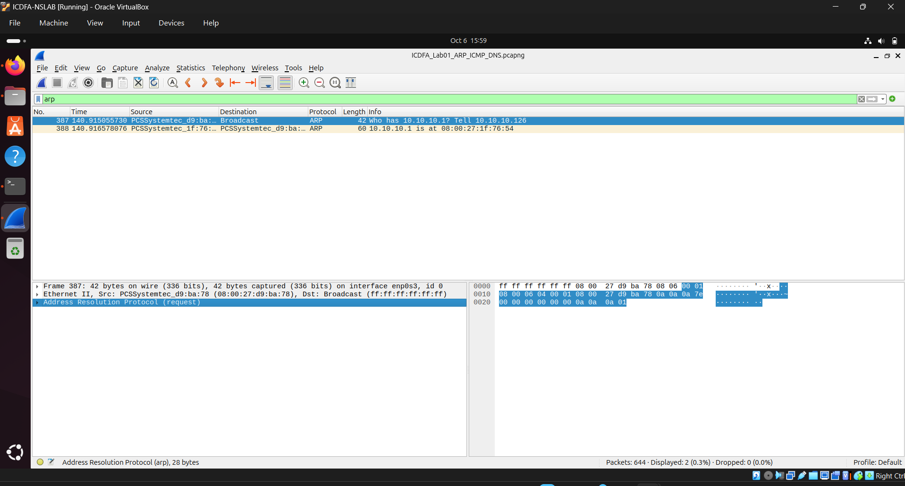

### ICMP

Using the icmp display filter, I observed four echo requests from 10.10.10.126 to 10.10.10.1 and four corresponding echo replies.

The request and reply pairs confirmed successful communication between the client and the gateway.

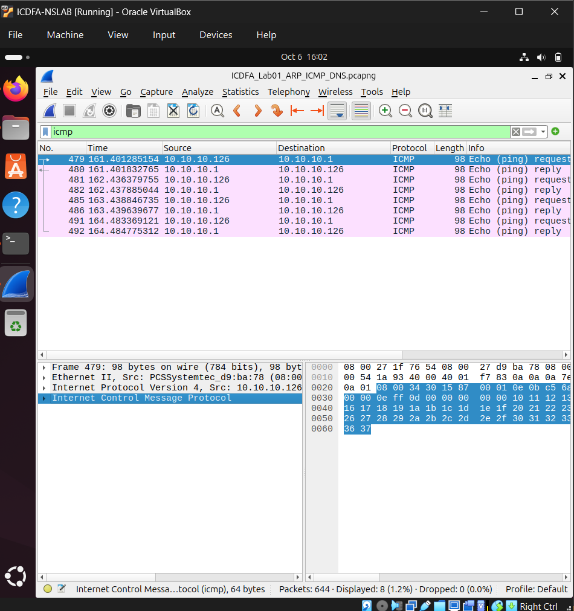

### DNS

I cleared the client's DNS cache and performed a name-resolution test while capturing:

    sudo resolvectl flush-caches
    getent hosts opnsense.org

I used the following display filter to isolate the relevant DNS packets:

    dns && dns.qry.name == "opnsense.org"

The capture contained an AAAA query and matching response with transaction ID 0xcef9. The response returned 2001:1af8:2050:a001:1::1.

This demonstrated a successful DNS exchange between Ubuntu and its configured DNS server.

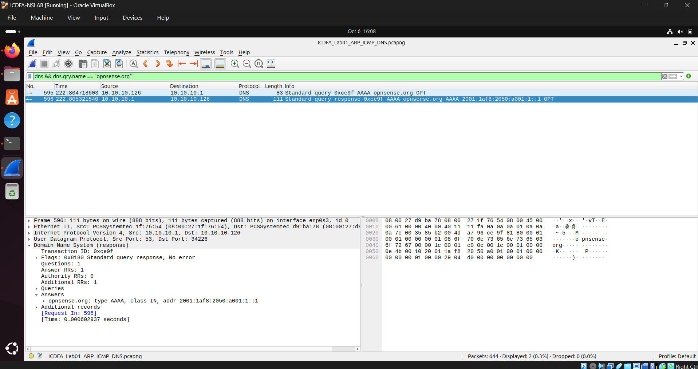

## 12. Completion Questions

The completion questions and answers are provided in [answers.md](answers.md).

## Conclusion

Through this laboratory, I learned how to connect an Ubuntu client to an OPNsense firewall using VirtualBox internal networking. I verified IPv4 addresses, subnet masks, interface status, routing and DNS configuration. I also learned that successful local connectivity does not guarantee internet connectivity, as the firewall needs a valid upstream route. Wireshark helped me identify how ARP discovers a local MAC address, ICMP tests connectivity, and DNS resolves a hostname to an IP address.
